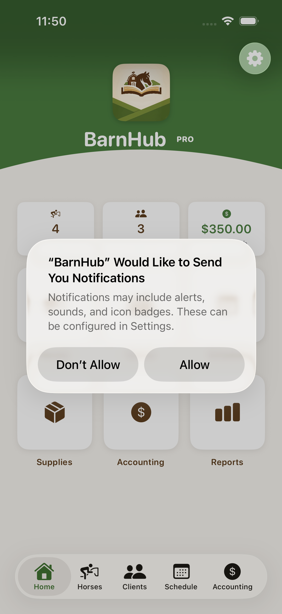
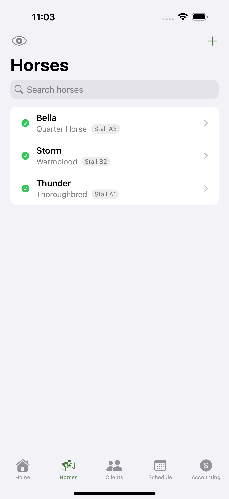
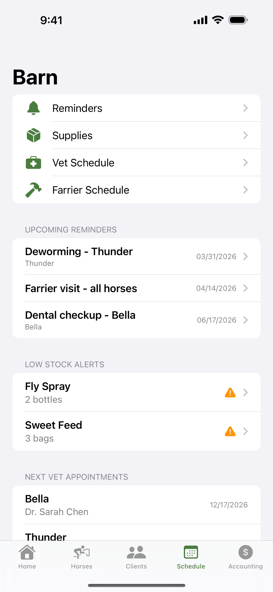
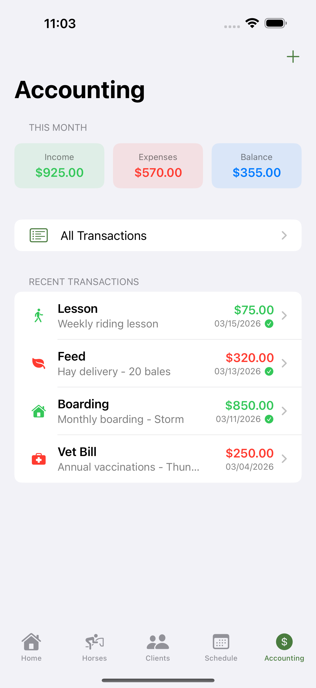

# BarnIO

<p align="center">
  
</p>

<p align="center">
  <strong>Barn management made simple.</strong><br>
  Track horses, clients, schedules, supplies, and finances — all in one app.
</p>

<p align="center">
  
  
  
  
</p>

## Features

- **Horses** — Manage your herd with breed, stall, weight, feeding schedules, medical notes, and activity status
- **Clients** — Track contact info, emergency contacts, horse assignments, and payment history
- **Schedule** — Reminders, vet appointments, farrier visits, and recurring task management
- **Supplies** — Inventory tracking with low-stock alerts and reorder thresholds
- **Accounting** — Income and expense tracking by category with monthly summaries
- **Reports** — Financial breakdowns by category with visual bar charts

## Tech Stack

- **SwiftUI** + **SwiftData** for a modern, declarative iOS experience
- **CloudKit** sync via SwiftData for seamless multi-device access
- **NavigationStack** with deep-linkable routes (`barnio://` URL scheme)
- CI/CD via **GitHub Actions** with automatic **TestFlight** deployment

## Requirements

- iOS 17.0+
- Xcode 15.0+

## Getting Started

```bash
git clone https://github.com/atomantic/BarnIO.git
cd BarnIO
open BarnIO.xcodeproj
```

Select a simulator or device and hit Run.

### Sample Data

To launch the app with sample data for development or screenshots:

1. In Xcode, edit the scheme (Product > Scheme > Edit Scheme)
2. Under Run > Arguments, add `-SeedSampleData` to launch arguments
3. Run the app — it will use an in-memory store populated with demo horses, clients, and transactions

## Screenshots

Screenshots can be regenerated automatically:

```bash
xcodebuild test \
  -project BarnIO.xcodeproj \
  -scheme BarnIO \
  -only-testing:BarnIOUITests/ScreenshotTests \
  -destination 'platform=iOS Simulator,name=iPhone 16 Pro Max'
```

## License

Copyright 2026 ShadowPuppet LLC. All rights reserved.
